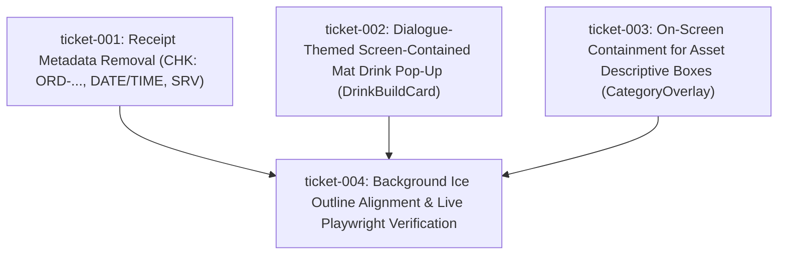

# Wayfinder Map — FS117: Receipt Metadata Removal, Dialogue-Themed Mat Drink Pop-Up, On-Screen Asset Descriptive Boxes, & Background Ice Outline Alignment

## Decomposition & Ticket Dependency Graph

## Ticket Summary
| Ticket ID | Title | Primary Files | Acceptance Criteria |
| --- | --- | --- | --- |
| `ticket-001` | Receipt Metadata Removal | `src/components/receipt/ReceiptPaper.tsx`, `src/lib/receipt/mapTicketToReceipt.ts` | `AC-01` (`INV-RECEIPT-NO-META-01`) |
| `ticket-002` | Dialogue-Themed Screen-Contained Mat Drink Pop-Up | `src/components/DrinkBuildCard.tsx`, `src/app/page.tsx`, `src/app/globals.css` | `AC-02`, `AC-03` (`INV-MAT-POPUP-DIALOGUE-01`) |
| `ticket-003` | On-Screen Containment for Asset Descriptive Boxes | `src/components/CategoryOverlay.tsx`, `src/app/globals.css` | `AC-04` (`INV-ASSET-BOX-ONSCREEN-01`) |
| `ticket-004` | Background Ice Outline Alignment & Playwright Verification | `src/data/povHotspots.ts` | `AC-05`, `AC-06` (`INV-ICE-ALIGN-01`, `INV-FAILFAST-01`) |
