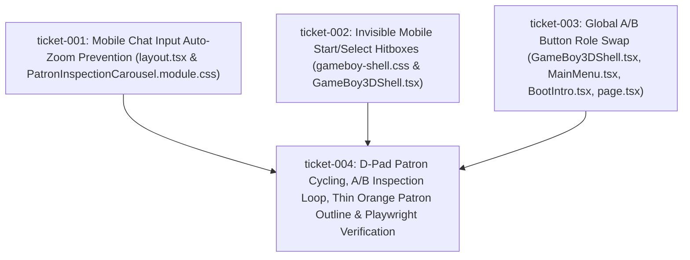

# Wayfinder Map — FS118: Mobile Chat Input Auto-Zoom Prevention, Invisible Mobile Start/Select Hitboxes, A/B Button Role Swap & D-Pad Patron Cycling with Thin Orange Silhouette Outlines

## Decomposition & Ticket Dependency Graph

## Ticket Summary
| Ticket ID | Title | Primary Files | Acceptance Criteria | Status |
| --- | --- | --- | --- | --- |
| `ticket-001` | Mobile Chat Input Auto-Zoom Prevention | `src/app/layout.tsx`, `src/components/PatronInspectionCarousel.module.css` | `AC-01` (`INV-NO-MOBILE-ZOOM-01`) | `completed` |
| `ticket-002` | Invisible Mobile Start/Select Hitboxes | `src/app/gameboy-shell.css`, `src/components/GameBoy3DShell.tsx` | `AC-02` (`INV-START-SELECT-TRANSPARENT-01`) | `completed` |
| `ticket-003` | Global A/B Button Role Swap | `src/components/GameBoy3DShell.tsx`, `src/components/MainMenu.tsx`, `src/components/BootIntro.tsx`, `src/app/page.tsx` | `AC-03` (`INV-AB-SWAP-01`) | `completed` |
| `ticket-004` | D-Pad Patron Cycling, Thin Orange Patron Outline & Live Playwright Verification | `src/components/PatronLayer.tsx`, `src/app/page.tsx`, `src/app/globals.css` | `AC-04`, `AC-05`, `AC-06` (`INV-DPAD-PATRON-LOOP-01`, `INV-PATRON-ORANGE-OUTLINE-01`, `INV-FAILFAST-01`) | `completed` |
